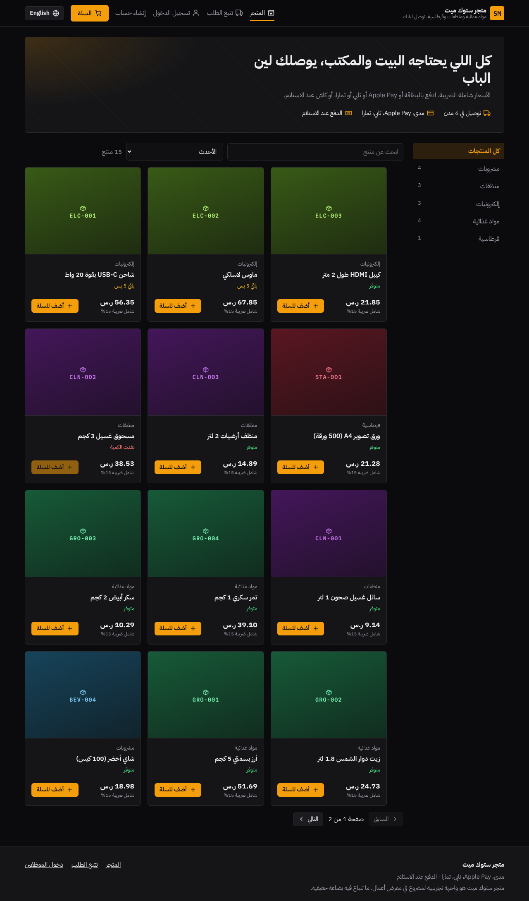
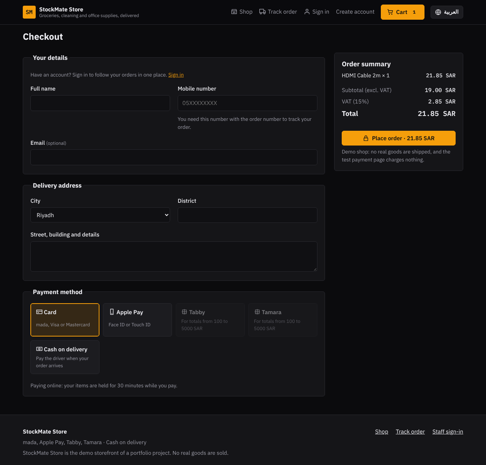
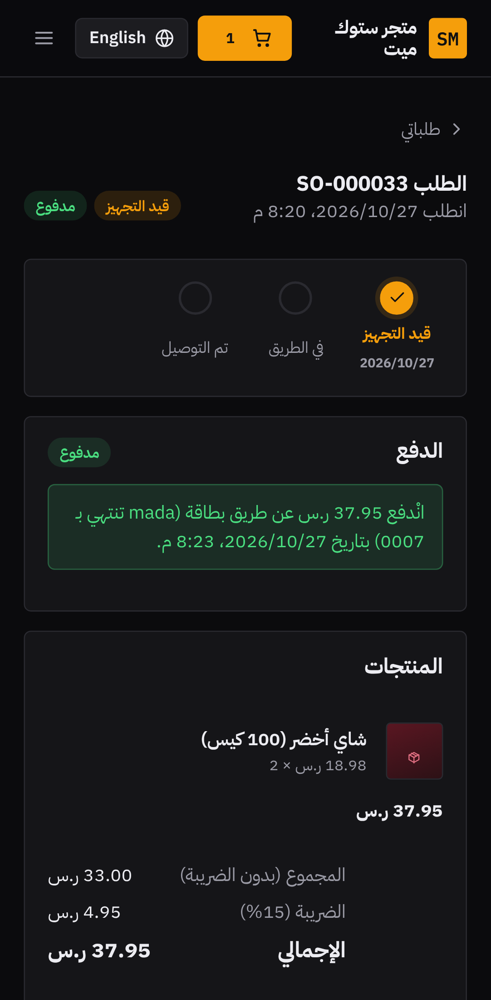
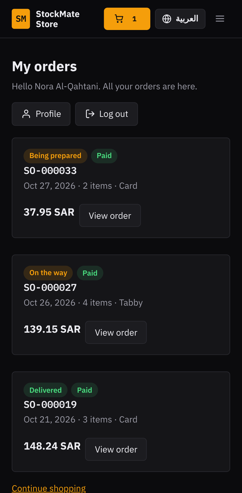

# StockMate Pro

Inventory, purchasing and sales management for small and medium shops and warehouses, **with its own online shop**, in **Arabic and English** (RTL / LTR). Visitors buy without an account, customers sign up to follow their orders, and staff run stock, shipping and payments from the office app.

**Stack:** a Java 21 / Spring Boot 4 REST API, an Angular 21 frontend and PostgreSQL 17, all run with Docker Compose.

[العربية ↓](#بالعربية)

| Online shop (Arabic) | Checkout (English) |
| --- | --- |
|  |  |

| Office dashboard (Arabic) | Stock movements (English) |
| --- | --- |
|  |  |

| Mobile: customer's order | Mobile: my orders | Mobile: sales orders |
| --- | --- | --- |
|  |  |  |

## Who uses it

| Role | What they can do |
| --- | --- |
| **Visitor** (no account) | Browse the shop, add to cart, check out with any payment method, track an order with its number + mobile number, pay or cancel it there |
| **Customer** (signs up with a mobile number) | Everything a visitor can, plus "My orders", pay later from the account, cancel, and edit their profile and password |
| **Staff** | Products, purchases, sales, stock, and shop orders: ship, deliver, record cash, cancel with a reason |
| **Admin** | Everything staff can, plus deleting records, staff accounts, and switching customer accounts off or on |

## Features

- **Online shop.** Products are published from the product form, with an Arabic name and descriptions in both languages. Prices are shown with VAT, stock shows as "in stock" or "only N left", and cost prices are never exposed. Categories, search, sort and paging live in the URL.
- **Cart and checkout.** The cart is kept in the browser and re-priced by the server on every change, so a withdrawn or sold-out product is flagged before checkout. Checkout takes stock at once under row locks, so the last unit cannot be sold twice. An order paid online holds its stock for 30 minutes (`SHOP_UNPAID_HOLD`); unpaid after that, it is cancelled and the stock returns.
- **Payments.** Card (mada, Visa, Mastercard) and Apple Pay through **Moyasar or Stripe**, instalments through **Tabby and Tamara** (100 to 5,000 SAR, 4 payments), and cash on delivery. See [Payments setup](#payments-setup).
- **Shipping in the office.** Shop orders appear in Sales with their channel, delivery and payment state. Staff ship a paid (or cash) order, mark it delivered (recording the driver's cash), record a bank transfer, or cancel it with a reason the customer sees; a paid order is refunded the way it was paid.
- **Abuse protection.** Checkout, sign-up and tracking are rate-limited per visitor IP, tracking needs both the order number and the phone, and checkout has a honeypot field for bots.

- **Products and categories.** Products have a SKU, a cost price, a sale price, a reorder level and an opening stock. You can search and filter them, page through the list, and archive them.
- **Purchase orders.** A draft order is received into stock, which also updates the product's weighted-average cost.
- **Sales orders.** Confirming a sale deducts stock. The server refuses to sell more than is available, even when two users confirm at the same moment, thanks to row-level locks. Cancelling a confirmed sale returns its stock.
- **Stock ledger.** Every change is recorded with its type, the running balance, the order reference, the user and the reason. Manual adjustments require a reason.
- **Saudi VAT (15%).** VAT is computed once on the order subtotal and rounded half-up. The order editor shows the same totals live, using integer halalas so they always match the server.
- **Dashboard.** It shows inventory value, sales and gross profit this month, a 14-day sales chart, top products, items to reorder and recent movements. "Today" and "this month" are measured in the Asia/Riyadh time zone.
- **Roles.** `ADMIN` can delete records and manage users. `STAFF` handles day-to-day work. `CUSTOMER` only reaches the shop and their own orders. Admins cannot demote or deactivate themselves.
- **Bilingual UI.** You can switch language without losing what you typed in a form. The choice is remembered, and every server error is translated using a stable error code.

## Quick start (Docker)

```bash
cp .env.example .env          # then set JWT_SECRET (e.g. openssl rand -base64 48) and DB_PASSWORD
docker compose up --build
```

Open <http://localhost:8081> for the shop, and <http://localhost:8081/login> for the office. The API documentation (Swagger UI) is at <http://localhost:8081/swagger-ui/index.html>.

**Database.** PostgreSQL runs in the `db` container and keeps its data in the `db-data` Docker volume. Flyway creates the tables when the API starts. To browse it, connect a tool such as DBeaver to `localhost:5441`, database `stockmate`, with `DB_USERNAME` / `DB_PASSWORD` from `.env`. Or run `docker compose exec db psql -U stockmate -d stockmate`. `docker compose down -v` deletes the data.

Demo accounts are created on the first start when `SEED_DEMO_DATA=true`:

| User | Password (default) | Role |
| --- | --- | --- |
| `admin` | `Admin@12345` | Admin |
| `staff` | `Staff@12345` | Staff |
| `0553001010` (Nora) or `0553001001` (Faisal) | `Customer@12345` | Shop customer, with past orders |

Change the passwords in `.env`. For a real installation, set `SEED_DEMO_DATA=false` and create users from the Users page.

## Payments setup

Without keys, every method uses the **built-in test gateway**: the customer is sent to `/pay/:id`, which shows test cards, an Apple Pay confirmation and the Tabby / Tamara plan. No real money moves. Test cards (any future expiry, any CVC):

| Card | Result |
| --- | --- |
| `5888 4500 0000 0003` (mada), `4111 1111 1111 1111` (Visa), `5105 1051 0510 5100` (Mastercard) | Approved |
| `4000 0000 0000 0002` | Declined |
| `4000 0000 0000 9995` | Insufficient funds |

To use the real gateways, put their **test** keys in `.env` and restart:

| Setting | Gateway |
| --- | --- |
| `CARD_PAYMENT_PROVIDER=MOYASAR` + `MOYASAR_SECRET_KEY` | Cards, mada and Apple Pay through a Moyasar invoice |
| `CARD_PAYMENT_PROVIDER=STRIPE` + `STRIPE_SECRET_KEY` | Cards and Apple Pay through Stripe Checkout |
| `TABBY_SECRET_KEY` + `TABBY_MERCHANT_CODE` | Tabby instalments (KSA API), sent with the order's items |
| `TAMARA_API_TOKEN` (+ `TAMARA_API_URL`, sandbox by default) | Tamara instalments, sent with the order's items |
| `PUBLIC_URL` | The shop address the gateways send the customer back to |

The customer pays on the gateway's own page and comes back to `/pay/:id?returned=1`; the server then asks the gateway for the result (and captures or authorises Tabby / Tamara orders). Keys stay on the server and card numbers never reach it.

## Deployment

Every green CI run on `main` publishes ready-to-run images for amd64 and arm64:
`ghcr.io/viylxp/stockmate-pro-backend` and `ghcr.io/viylxp/stockmate-pro-frontend` (workflow `release.yml`).
The production server runs this app together with the other two Pro apps behind Caddy with automatic HTTPS,
nightly database backups, an optional nightly demo-data reset and automatic updates. Server files and steps: [`masar-pro/deploy`](https://github.com/viYLxP/masar-pro/tree/main/deploy).

## Local development

You need Java 21, Node 22 and Docker (for PostgreSQL and the Testcontainers tests).

```bash
docker run -d --name stockmate-db -e POSTGRES_DB=stockmate -e POSTGRES_USER=stockmate \
  -e POSTGRES_PASSWORD=stockmate -p 5432:5432 postgres:17-alpine
cd backend && ./mvnw spring-boot:run          # API on :8080
cd frontend && npm ci && npm start            # UI on :4200, /api is proxied to :8080
```

## Tests and checks

| Command | What it checks |
| --- | --- |
| `cd backend && ./mvnw verify` | 55 tests. Integration tests use a real PostgreSQL via Testcontainers: auth and roles, validation, order flows, a concurrent oversell test, the shop (checkout, stock, tracking, expiry, refunds), customer accounts, rate limits and demo-data consistency. Unit tests cover the domain rules and each payment gateway adapter against mocked HTTP. |
| `cd frontend && npm run lint` | ESLint, including the Angular template accessibility rules |
| `cd frontend && npm run format:check` | Prettier |
| `cd frontend && npm run check:i18n` | Every translation key used in templates exists |
| `cd frontend && npm run test:ci` | 44 unit tests: money and VAT maths, cart, guards, payment panel, order view, error mapping, Arabic/English dictionary parity |
| `cd e2e && npm ci && npx playwright test` | 40 browser tests (20 scenarios × desktop and mobile) against the running stack: guest cash and card orders, tracking, cancelling with stock returned, sign-up with Tabby, staff shipping and delivery, refunds, layout in both languages |

GitHub Actions runs all of these on every push. See `.github/workflows/ci.yml`.

## Project structure

```
backend/    Spring Boot API: one package per feature (product, stock, purchase, sales, shop, payment, account, dashboard, user, ...)
  src/main/resources/db/migration   Flyway SQL migrations (the schema is never auto-generated)
frontend/   Angular app: core/ (api, auth, cart, i18n, ui), features/ (shop, account, pay and office pages), shared/, layout/ (shop and office)
e2e/        Playwright end-to-end tests
docs/       Screenshots
```

## Design decisions

- **Stock only changes through the ledger.** `StockService.record` is the single place that changes a quantity, and it must run inside the caller's transaction. That way a quantity can never change without a matching movement row.
- **Pessimistic locks on confirm and receive.** Products are locked in id order to avoid deadlocks. Optimistic locking (`version`) protects edits made in forms.
- **Errors use RFC 9457 Problem Details** with a machine-readable `code`. The UI translates the code, so server messages are never shown raw.
- **Stateless JWT authentication** uses HMAC-SHA256. The secret is required at startup and must be at least 32 characters.

## Known limitations

- **The real gateways were not called from the development machine** (its network blocks them). Their adapters follow each provider's documented API and are tested against mocked HTTP responses; the full payment flow was tested end to end with the built-in test gateway. Try them with test keys before going live.
- Gateway webhooks are not implemented yet: a payment is confirmed when the customer returns to the site or opens the payment link again. An order whose customer never returns is cancelled by the unpaid-order timer.
- There are no SMS or email notifications; customers follow orders in their account or on the tracking page. There are no product photos (tiles show the category colour and SKU).
- The rate limiter keeps its counters in memory, so it is per API instance. Several instances would need a shared store such as Redis.

- The product pickers in the order editor and the movements filter load up to 100 products. A larger catalogue would need a search-as-you-type picker.
- The Docker images are built and started in CI. On the development machine used for this project, the stack was verified with the same runtime images and locally built artifacts.

---

## بالعربية

**StockMate Pro** نظام لإدارة المخزون والمشتريات والمبيعات للمحلات والمستودعات الصغيرة والمتوسطة، **ومعه متجر إلكتروني خاص فيه**. واجهته **بالعربي والإنجليزي** (من اليمين لليسار ومن اليسار لليمين). الزائر يشتري بدون حساب، والعميل يسجّل عشان يتابع طلباته، والموظفين يديرون المخزون والشحن والمدفوعات من تطبيق المكتب.

### مين يستخدمه

| الدور | وش يقدر يسوي |
| --- | --- |
| **الزائر** (بدون حساب) | يتصفح المتجر، ويضيف للسلة، ويطلب بأي طريقة دفع، ويتتبع طلبه برقم الطلب + الجوال، ويدفع أو يلغي من هناك |
| **العميل** (يسجّل برقم جواله) | كل اللي يسويه الزائر، وفوقها "طلباتي"، والدفع لاحقًا من الحساب، والإلغاء، وتعديل ملفه وكلمة المرور |
| **الموظف** | المنتجات والمشتريات والمبيعات والمخزون، وطلبات المتجر: شحن، وتوصيل، وتسجيل الكاش، وإلغاء مع سبب |
| **المدير** | كل اللي يسويه الموظف، وفوقها الحذف، وحسابات الموظفين، وإيقاف أو تشغيل حسابات العملاء |

**التقنيات:** واجهة برمجية (API) بـ Java 21 وSpring Boot 4، وواجهة مستخدم بـ Angular 21، وقاعدة بيانات PostgreSQL 17، وكلها تشتغل بـ Docker Compose.

### المزايا

- **المتجر الإلكتروني.** المنتج ينعرض في المتجر من نموذج المنتج، مع اسم عربي ووصف باللغتين. الأسعار شاملة الضريبة، والمخزون يظهر "متوفر" أو "باقي N"، وسعر التكلفة ما ينعرض أبدًا.
- **السلة وإتمام الطلب.** السلة محفوظة في المتصفح، والخادم يعيد تسعيرها مع كل تغيير، فالمنتج المسحوب أو اللي خلص ينبّه عليه قبل الدفع. إتمام الطلب ياخذ المخزون فورًا بقفل الصفوف، فآخر حبة ما تنباع مرتين. والطلب المدفوع أونلاين يحجز مخزونه 30 دقيقة (`SHOP_UNPAID_HOLD`)؛ ولو ما اندفع ينلغي ويرجع المخزون.
- **المدفوعات.** بطاقة (مدى وفيزا وماستركارد) وApple Pay عن طريق **ميسّر أو Stripe**، وتقسيط **تابي وتمارا** (من 100 إلى 5,000 ريال، 4 دفعات)، والدفع عند الاستلام.
- **الشحن من المكتب.** طلبات المتجر تظهر في المبيعات مع القناة وحالة التوصيل والدفع. الموظف يشحن الطلب المدفوع (أو الكاش)، ويسجّل التوصيل (مع الكاش اللي استلمه المندوب)، أو يسجّل تحويل بنكي، أو يلغي مع سبب يشوفه العميل؛ والطلب المدفوع ينرد بنفس طريقة الدفع.
- **الحماية من العبث.** إتمام الطلب والتسجيل والتتبع لها حد لكل IP، والتتبع يحتاج رقم الطلب والجوال مع بعض، ونموذج الطلب فيه مصيدة للبوتات.

- **المنتجات والتصنيفات.** لكل منتج رمز وسعر تكلفة وسعر بيع وحد إعادة طلب ورصيد افتتاحي. فيها بحث وفلاتر وتقسيم صفحات وأرشفة.
- **طلبات الشراء.** المسودة تُستلم في المخزون، ومع الاستلام يتحدّث متوسط التكلفة المرجّح.
- **طلبات البيع.** التأكيد يخصم من المخزون. الخادم يرفض البيع بأكثر من المتوفر حتى لو أكّد مستخدمَين بنفس اللحظة، بفضل أقفال الصفوف. إلغاء بيع مؤكد يرجّع المخزون.
- **سجل المخزون.** كل تغيير مسجل مع نوعه والرصيد بعده ورقم الطلب والمستخدم والسبب. والتسوية اليدوية تتطلب سببًا.
- **ضريبة القيمة المضافة (15%).** تُحسب مرة وحدة على المجموع وتُقرّب لأعلى عند النصف. محرر الطلب يعرض نفس الإجماليات مباشرة بالهللات الصحيحة، فتطابق الخادم دائمًا.
- **لوحة التحكم.** تعرض قيمة المخزون، ومبيعات وأرباح الشهر، ورسم آخر 14 يوم، والأكثر مبيعًا، والأصناف اللي تحتاج إعادة طلب، وآخر الحركات. "اليوم" و"الشهر" محسوبين بتوقيت الرياض.
- **الصلاحيات.** المدير يقدر يحذف ويدير المستخدمين، والموظف للعمل اليومي. والمدير ما يقدر ينزّل صلاحيته أو يعطّل حسابه بنفسه.
- **واجهة بلغتين.** تقدر تبدّل اللغة بدون ما تضيع البيانات المكتوبة في النماذج، والاختيار ينحفظ. وكل خطأ من الخادم يُترجم عن طريق رمز خطأ ثابت.

### التشغيل السريع

```bash
cp .env.example .env          # ثم عيّن JWT_SECRET (مثلًا openssl rand -base64 48) وDB_PASSWORD
docker compose up --build
```

افتح <http://localhost:8081> للمتجر، و<http://localhost:8081/login> للمكتب. توثيق الـ API (Swagger) على <http://localhost:8081/swagger-ui/index.html>.

**قاعدة البيانات.** PostgreSQL يشتغل داخل حاوية `db` وبياناته محفوظة في volume اسمه `db-data`. والجداول ينشئها Flyway تلقائيًا لما يشتغل الـ API. عشان تتصفحها، وصّل أداة مثل DBeaver على `localhost:5441`، قاعدة البيانات `stockmate`، باسم المستخدم وكلمة المرور من `.env` (`DB_USERNAME` و`DB_PASSWORD`). أو شغّل `docker compose exec db psql -U stockmate -d stockmate`. والأمر `docker compose down -v` يحذف البيانات.

الحسابات التجريبية تنشأ أول مرة إذا كان `SEED_DEMO_DATA=true`:

| المستخدم | كلمة المرور (الافتراضية) | الدور |
| --- | --- | --- |
| `admin` | `Admin@12345` | مدير |
| `staff` | `Staff@12345` | موظف |
| `0553001010` (نورة) أو `0553001001` (فيصل) | `Customer@12345` | عميل في المتجر وعنده طلبات سابقة |

**الدفع:** بدون مفاتيح، كل الطرق تستخدم البوابة التجريبية المدمجة (بدون فلوس حقيقية). البطاقة `4111 1111 1111 1111` تنقبل، و`4000 0000 0000 0002` ترتفض. وللبوابات الحقيقية حط مفاتيحها التجريبية في `.env` (`CARD_PAYMENT_PROVIDER` و`MOYASAR_SECRET_KEY` أو `STRIPE_SECRET_KEY`، و`TABBY_SECRET_KEY` و`TABBY_MERCHANT_CODE`، و`TAMARA_API_TOKEN`). التفاصيل في قسم Payments setup فوق.

غيّر كلمات المرور في `.env`. وفي التشغيل الفعلي خلّ `SEED_DEMO_DATA=false` وأنشئ المستخدمين من صفحة المستخدمين.

### الرفع على سيرفر

كل تشغيل CI ناجح على `main` ينشر صور جاهزة (amd64 وarm64) في `ghcr.io/viylxp/stockmate-pro-backend` و`-frontend`.
والسيرفر يشغّل هذا التطبيق مع تطبيقي Pro الثانيين خلف Caddy بشهادة HTTPS تلقائية، ونسخ احتياطي يومي،
وتصفير اختياري لبيانات العرض كل ليلة، وتحديث تلقائي. الملفات والخطوات: [`masar-pro/deploy`](https://github.com/viYLxP/masar-pro/tree/main/deploy).

### الاختبارات

- **الباكند:** 55 اختبار على PostgreSQL حقيقي. تغطي الدخول والصلاحيات، ومسار الطلبات، والبيع المتزامن، والمتجر (الطلب والمخزون والتتبع وانتهاء المهلة والاسترداد)، وحسابات العملاء، وحدود المحاولات، وكل بوابة دفع على ردود HTTP وهمية.
- **الفرونت:** 44 اختبار وحدة، مع فحص ESLint (يشمل قواعد الوصولية) وPrettier، وفحص إن كل مفاتيح الترجمة موجودة.
- **اختبارات المتصفح (Playwright):** 40 اختبار على النظام وهو شغال: طلب زائر كاش وبطاقة، والتتبع، والإلغاء ورجوع المخزون، والتسجيل والدفع بتابي، وشحن وتوصيل الموظف، والاسترداد، والتصميم باللغتين على الكمبيوتر والجوال.

كلها تشتغل تلقائيًا في GitHub Actions مع كل push.

### حدود معروفة

- **البوابات الحقيقية ما انْتصل فيها من جهاز التطوير** (الشبكة تحجبها). محولاتها مبنية على توثيق كل مزوّد ومختبرة على ردود وهمية؛ ومسار الدفع كامل مختبر بالبوابة التجريبية. جرّبها بمفاتيح تجريبية قبل التشغيل الفعلي.
- ما فيه webhooks للبوابات حاليًا: الدفع يتأكد لما يرجع العميل للموقع أو يفتح رابط الدفع مرة ثانية. والطلب اللي ما رجع صاحبه ينلغي بمؤقت الطلبات غير المدفوعة.
- ما فيه رسائل SMS أو إيميل، وما فيه صور للمنتجات (البطاقة تعرض لون التصنيف ورمز المنتج).

- قوائم اختيار المنتج في محرر الطلب وفلتر الحركات تحمّل حتى 100 منتج. لو صار الكتالوج أكبر يحتاج منتقي بالبحث أثناء الكتابة.
- صور Docker تُبنى وتشتغل في CI. وعلى جهاز التطوير المستخدم لهذا المشروع، اختبرنا النظام بنفس صور التشغيل مع ملفات مبنية محليًا.
