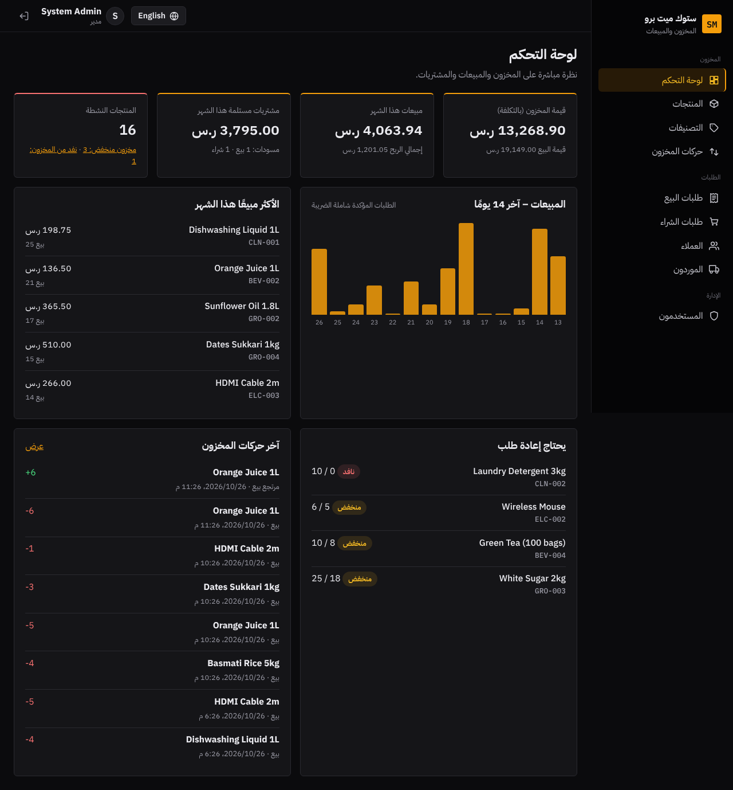
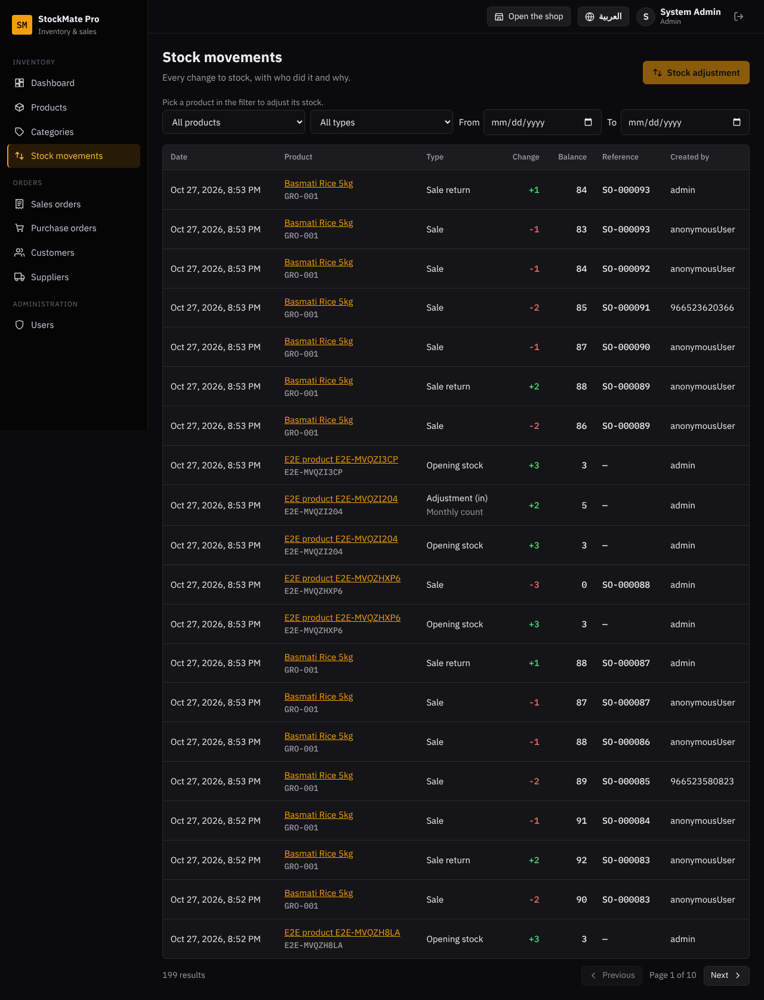
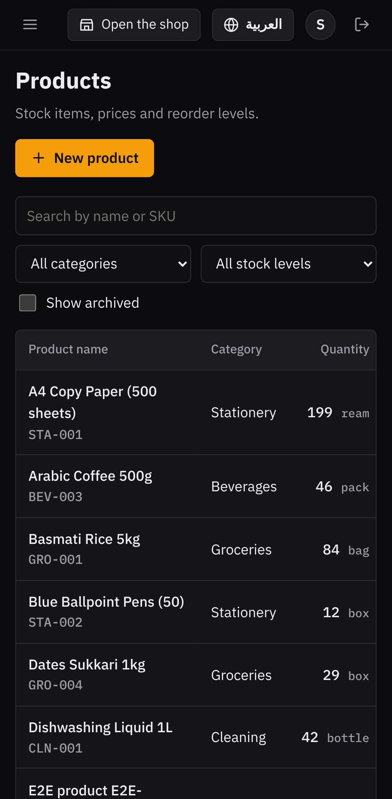
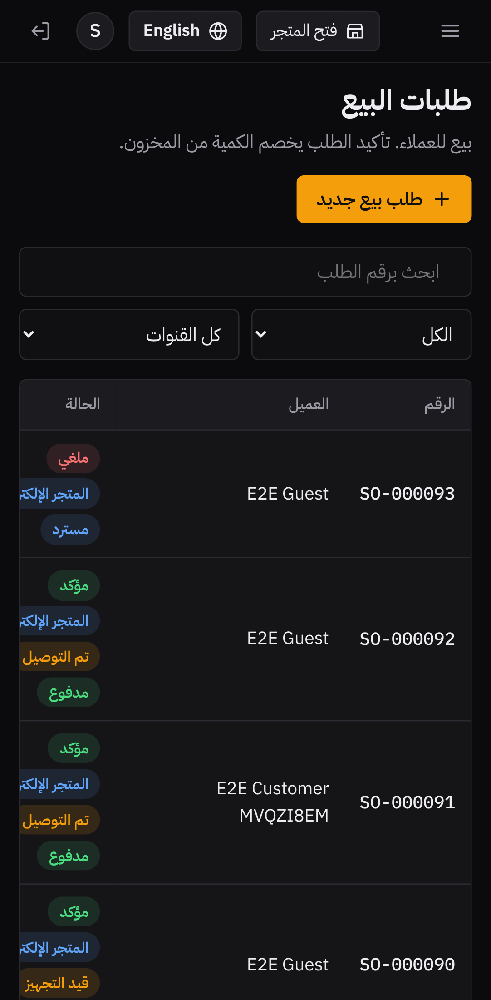

# StockMate Pro

Inventory, purchasing and sales management for small and medium shops and warehouses, in **Arabic and English** (RTL / LTR).

**Stack:** a Java 21 / Spring Boot 4 REST API, an Angular 21 frontend and PostgreSQL 17, all run with Docker Compose.

[العربية ↓](#بالعربية)

| Dashboard (Arabic) | Stock movements (English) |
| --- | --- |
|  |  |

| Mobile: products | Mobile: sales orders |
| --- | --- |
|  |  |

## Features

- **Products and categories.** Products have a SKU, a cost price, a sale price, a reorder level and an opening stock. You can search and filter them, page through the list, and archive them.
- **Purchase orders.** A draft order is received into stock, which also updates the product's weighted-average cost.
- **Sales orders.** Confirming a sale deducts stock. The server refuses to sell more than is available, even when two users confirm at the same moment, thanks to row-level locks. Cancelling a confirmed sale returns its stock.
- **Stock ledger.** Every change is recorded with its type, the running balance, the order reference, the user and the reason. Manual adjustments require a reason.
- **Saudi VAT (15%).** VAT is computed once on the order subtotal and rounded half-up. The order editor shows the same totals live, using integer halalas so they always match the server.
- **Dashboard.** It shows inventory value, sales and gross profit this month, a 14-day sales chart, top products, items to reorder and recent movements. "Today" and "this month" are measured in the Asia/Riyadh time zone.
- **Roles.** `ADMIN` can delete records and manage users. `STAFF` handles day-to-day work. Admins cannot demote or deactivate themselves.
- **Bilingual UI.** You can switch language without losing what you typed in a form. The choice is remembered, and every server error is translated using a stable error code.

## Quick start (Docker)

```bash
cp .env.example .env          # then set JWT_SECRET (e.g. openssl rand -base64 48) and DB_PASSWORD
docker compose up --build
```

Open <http://localhost:8081>. The API documentation (Swagger UI) is at <http://localhost:8081/swagger-ui/index.html>.

**Database.** PostgreSQL runs in the `db` container and keeps its data in the `db-data` Docker volume. Flyway creates the tables when the API starts. To browse it, connect a tool such as DBeaver to `localhost:5441`, database `stockmate`, with `DB_USERNAME` / `DB_PASSWORD` from `.env`. Or run `docker compose exec db psql -U stockmate -d stockmate`. `docker compose down -v` deletes the data.

Demo accounts are created on the first start when `SEED_DEMO_DATA=true`:

| User | Password (default) | Role |
| --- | --- | --- |
| `admin` | `Admin@12345` | Admin |
| `staff` | `Staff@12345` | Staff |

Change the passwords in `.env`. For a real installation, set `SEED_DEMO_DATA=false` and create users from the Users page.

## Local development

You need Java 21, Node 22 and Docker (for PostgreSQL and the Testcontainers tests).

```bash
docker run -d --name stockmate-db -e POSTGRES_DB=stockmate -e POSTGRES_USER=stockmate \
  -e POSTGRES_PASSWORD=stockmate -p 5432:5432 postgres:17-alpine
cd backend && ./mvnw spring-boot:run          # API on :8080
cd frontend && npm ci && npm start            # UI on :4200, /api is proxied to :8080
```

## Tests and checks

| Command | What it checks |
| --- | --- |
| `cd backend && ./mvnw verify` | 28 tests. Integration tests use a real PostgreSQL via Testcontainers: auth and roles, validation, order flows, a concurrent oversell test and demo-data consistency. There are also unit tests for the domain rules. |
| `cd frontend && npm run lint` | ESLint, including the Angular template accessibility rules |
| `cd frontend && npm run format:check` | Prettier |
| `cd frontend && npm run check:i18n` | Every translation key used in templates exists |
| `cd frontend && npm run test:ci` | 19 unit tests: money and VAT maths, error mapping, Arabic/English dictionary parity, date filters |
| `cd e2e && npm ci && npx playwright test` | 22 browser tests (11 scenarios × desktop and mobile) against the running stack |

GitHub Actions runs all of these on every push. See `.github/workflows/ci.yml`.

## Project structure

```
backend/    Spring Boot API: one package per feature (product, stock, purchase, sales, dashboard, user, ...)
  src/main/resources/db/migration   Flyway SQL migrations (the schema is never auto-generated)
frontend/   Angular app: core/ (api, auth, i18n, ui), features/ (one folder per page), layout/
e2e/        Playwright end-to-end tests
docs/       Screenshots
```

## Design decisions

- **Stock only changes through the ledger.** `StockService.record` is the single place that changes a quantity, and it must run inside the caller's transaction. That way a quantity can never change without a matching movement row.
- **Pessimistic locks on confirm and receive.** Products are locked in id order to avoid deadlocks. Optimistic locking (`version`) protects edits made in forms.
- **Errors use RFC 9457 Problem Details** with a machine-readable `code`. The UI translates the code, so server messages are never shown raw.
- **Stateless JWT authentication** uses HMAC-SHA256. The secret is required at startup and must be at least 32 characters.

## Known limitations

- The product pickers in the order editor and the movements filter load up to 100 products. A larger catalogue would need a search-as-you-type picker.
- The Docker images are built and started in CI. On the development machine used for this project, the stack was verified with the same runtime images and locally built artifacts.

---

## بالعربية

**StockMate Pro** نظام لإدارة المخزون والمشتريات والمبيعات للمحلات والمستودعات الصغيرة والمتوسطة. واجهته **بالعربي والإنجليزي** (من اليمين لليسار ومن اليسار لليمين).

**التقنيات:** واجهة برمجية (API) بـ Java 21 وSpring Boot 4، وواجهة مستخدم بـ Angular 21، وقاعدة بيانات PostgreSQL 17، وكلها تشتغل بـ Docker Compose.

### المزايا

- **المنتجات والتصنيفات.** لكل منتج رمز وسعر تكلفة وسعر بيع وحد إعادة طلب ورصيد افتتاحي. فيها بحث وفلاتر وتقسيم صفحات وأرشفة.
- **طلبات الشراء.** المسودة تُستلم في المخزون، ومع الاستلام يتحدّث متوسط التكلفة المرجّح.
- **طلبات البيع.** التأكيد يخصم من المخزون. الخادم يرفض البيع بأكثر من المتوفر حتى لو أكّد مستخدمَين بنفس اللحظة، بفضل أقفال الصفوف. إلغاء بيع مؤكد يرجّع المخزون.
- **سجل المخزون.** كل تغيير مسجل مع نوعه والرصيد بعده ورقم الطلب والمستخدم والسبب. والتسوية اليدوية تتطلب سببًا.
- **ضريبة القيمة المضافة (15%).** تُحسب مرة وحدة على المجموع وتُقرّب لأعلى عند النصف. محرر الطلب يعرض نفس الإجماليات مباشرة بالهللات الصحيحة، فتطابق الخادم دائمًا.
- **لوحة التحكم.** تعرض قيمة المخزون، ومبيعات وأرباح الشهر، ورسم آخر 14 يوم، والأكثر مبيعًا، والأصناف اللي تحتاج إعادة طلب، وآخر الحركات. "اليوم" و"الشهر" محسوبين بتوقيت الرياض.
- **الصلاحيات.** المدير يقدر يحذف ويدير المستخدمين، والموظف للعمل اليومي. والمدير ما يقدر ينزّل صلاحيته أو يعطّل حسابه بنفسه.
- **واجهة بلغتين.** تقدر تبدّل اللغة بدون ما تضيع البيانات المكتوبة في النماذج، والاختيار ينحفظ. وكل خطأ من الخادم يُترجم عن طريق رمز خطأ ثابت.

### التشغيل السريع

```bash
cp .env.example .env          # ثم عيّن JWT_SECRET (مثلًا openssl rand -base64 48) وDB_PASSWORD
docker compose up --build
```

افتح <http://localhost:8081>. توثيق الـ API (Swagger) على <http://localhost:8081/swagger-ui/index.html>.

**قاعدة البيانات.** PostgreSQL يشتغل داخل حاوية `db` وبياناته محفوظة في volume اسمه `db-data`. والجداول ينشئها Flyway تلقائيًا لما يشتغل الـ API. عشان تتصفحها، وصّل أداة مثل DBeaver على `localhost:5441`، قاعدة البيانات `stockmate`، باسم المستخدم وكلمة المرور من `.env` (`DB_USERNAME` و`DB_PASSWORD`). أو شغّل `docker compose exec db psql -U stockmate -d stockmate`. والأمر `docker compose down -v` يحذف البيانات.

الحسابات التجريبية تنشأ أول مرة إذا كان `SEED_DEMO_DATA=true`:

| المستخدم | كلمة المرور (الافتراضية) | الدور |
| --- | --- | --- |
| `admin` | `Admin@12345` | مدير |
| `staff` | `Staff@12345` | موظف |

غيّر كلمات المرور في `.env`. وفي التشغيل الفعلي خلّ `SEED_DEMO_DATA=false` وأنشئ المستخدمين من صفحة المستخدمين.

### الاختبارات

- **الباكند:** 28 اختبار على PostgreSQL حقيقي. تغطي الدخول والصلاحيات، والتحقق من المدخلات، ومسار الطلبات، واختبار بيع متزامن يمنع البيع بأكثر من المتوفر، وسلامة البيانات التجريبية.
- **الفرونت:** 19 اختبار وحدة، مع فحص ESLint (يشمل قواعد الوصولية) وPrettier، وفحص إن كل مفاتيح الترجمة موجودة.
- **اختبارات المتصفح (Playwright):** 22 اختبار على النظام وهو شغال، بالعربي والإنجليزي، على الكمبيوتر والجوال.

كلها تشتغل تلقائيًا في GitHub Actions مع كل push.

### حدود معروفة

- قوائم اختيار المنتج في محرر الطلب وفلتر الحركات تحمّل حتى 100 منتج. لو صار الكتالوج أكبر يحتاج منتقي بالبحث أثناء الكتابة.
- صور Docker تُبنى وتشتغل في CI. وعلى جهاز التطوير المستخدم لهذا المشروع، اختبرنا النظام بنفس صور التشغيل مع ملفات مبنية محليًا.
